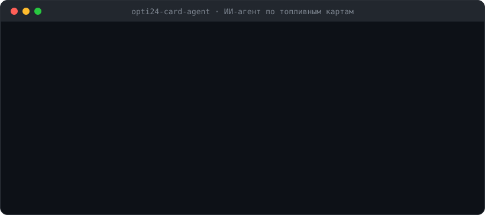
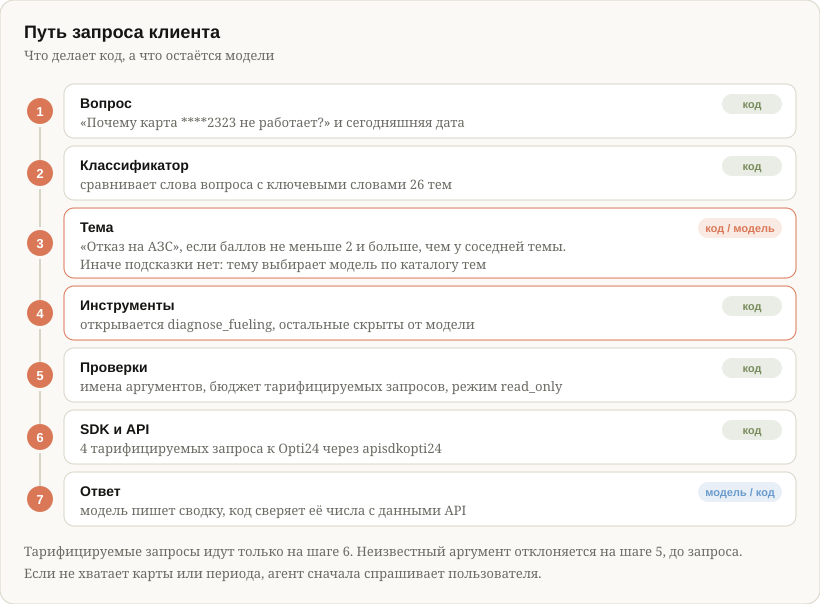

# Агент контроля топливных карт

> [!WARNING]
> Неофициальный проект. Он не связан с оператором топливных карт ОПТИ 24 и не одобрен им.
> Работает через [apisdkopti24](https://github.com/raspopovaa/apisdkopti24). Это прототип:
> сначала проверяйте на DEMO. Инструмент блокировки карт выключен по умолчанию (`read_only`)
> и включается только осознанно (`AGENT_MODE=confirm`). Лицензия MIT, без гарантий.

Первый одиночный ИИ-агент проекта ALTΔ. Принимает вопросы по-русски, сам решает,
какие методы API топливных карт вызвать (через `apisdkopti24`, Opti24), считает
расходы кодом и отвечает коротко. Изменения (блокировка карт) делает только после
подтверждения человека.

<p align="center">
  
</p>

```
python -m agent.dashboard    # только дашборд договора, без модели и без ключей ИИ
python -m agent              # дашборд + диалог в терминале
python scripts/smoke_test.py # проверка на настоящем API (DEMO), без модели
pytest                       # 403 теста без сети и без ключей
ruff check agent scripts evals tests && mypy agent  # проверки качества кода, их же запускает CI
python scripts/estimate_cost.py
python evals/run_retrieval.py   # качество поиска по базе знаний: hit@3 и «ответа нет», без модели
python evals/run_evals.py --runs 3  # оценка агента: инструменты и их аргументы (нужен ключ модели)
python evals/run_evals_claude.py --model claude-haiku-5-5  # то же без API-ключа: через Claude Code по подписке
```

### Веб-дашборд на своём компьютере

```bash
python -m agent.web   # http://localhost:8765, данные DEMO
```

Те же показатели, что в терминале, плюс полосы по топливу и картам. Сервер слушает только
`127.0.0.1`, внешних скриптов нет. Кнопка «Обновить» делает новые тарифицируемые запросы
(до 4), данные кешируются на минуту.

## Быстрый запуск на разных моделях

Агент работает с любой моделью, которая умеет вызывать инструменты. Меняются только провайдер,
ключ и имя модели, код трогать не нужно. Все команды выполняйте в папке проекта.

**Что нужно заранее:**

- Python 3.11 или новее и зависимости: `pip install -r requirements.txt`.
- Учётные данные Opti24 в `.env.demo` или `~/.opti24-demo.env` (шаблон — `.env.example`).
- Адрес, с которого вы работаете, из страны, которую принимает API: RU, BY, KZ, TJ, KG, IQ, AE,
  RS. Через VPN с выходом в другой стране вход отклоняется. Проверка без модели и без траты
  пакета запросов: `python scripts/check_access.py`.
- Ключ модели вводите скрыто (`read -s`) и не вставляйте в чат и в историю команд.

### Примеры

**DeepSeek-V4-Flash в облаке Cloud.ru** (по умолчанию; российский провайдер, OpenAI-совместимый адрес
`https://foundation-models.api.cloud.ru/v1`):

```bash
read -s "AGENT_API_KEY?Ключ Cloud.ru: " && export AGENT_API_KEY
python -m agent
```

Другую модель Cloud.ru задайте через `AGENT_MODEL`, имя берите из каталога Foundation Models.

**Claude Haiku 5.5**:

```bash
read -s "ANTHROPIC_API_KEY?Ключ Anthropic: " && export ANTHROPIC_API_KEY
python -m agent --provider claude
```

**Claude Sonnet 5.5**, если Haiku не справляется с вашими вопросами:

```bash
python -m agent --provider claude --model claude-sonnet-5-5
```

**DeepSeek** через его собственный API:

```bash
read -s "DEEPSEEK_API_KEY?Ключ DeepSeek: " && export DEEPSEEK_API_KEY
python -m agent --provider deepseek
```

**YandexGPT** (Yandex AI Studio; имя модели собирается из ID каталога):

```bash
read -s "YANDEX_API_KEY?Ключ Yandex Cloud: " && export YANDEX_API_KEY YANDEX_FOLDER_ID=<ID-каталога>
python -m agent --provider yandex
```

**Локальный сервер vLLM**: модель работает на вашем компьютере или сервере, данные не уходят наружу.
Сервер запускается отдельно, агент подключается к нему по OpenAI-совместимому адресу
`http://localhost:8000/v1`. Флаги `--enable-auto-tool-choice` и `--tool-call-parser hermes`
нужны, чтобы модель могла вызывать инструменты:

```bash
vllm serve Qwen/Qwen2.5-7B-Instruct --enable-auto-tool-choice --tool-call-parser hermes
python -m agent --provider vllm --model Qwen/Qwen2.5-7B-Instruct
```

Другой адрес задайте через `AGENT_BASE_URL`. Имя модели должно совпадать с тем, что сервер
отдаёт при запуске. Ключ не нужен, пока сервер запущен без `--api-key`.

**Локальная модель через Ollama**: ключи и интернет не нужны, данные остаются на компьютере.
Небольшие модели (3–4 млрд параметров) плохо выбирают инструменты, проверьте их на `evals/`:

```bash
ollama pull qwen3:8b
python -m agent --provider ollama --model qwen3:8b
```

**OpenAI**:

```bash
read -s "OPENAI_API_KEY?Ключ OpenAI: " && export OPENAI_API_KEY
python -m agent --provider openai
```

### Что проверено

| Модель | Как проверена |
|---|---|
| Claude Haiku 5.5 | 30 кейсов `evals/` из 30 через Claude Code по подписке; цикл вёл Claude Code, поэтому результат приблизительный |
| DeepSeek-V4-Flash (Cloud.ru) | 24 кейса из 30 при первом прогоне с проверкой ответа (22.10.2026). Пять из шести провалов — ошибки проверки чисел (жирный шрифт и пустой период), исправлены; повторный прогон не делался. Оставшийся провал — три вызова `list_cards` подряд в поиске карты по имени (ограничение модели). Диалог на DEMO и на рабочем договоре в режиме только чтения |
| DeepSeek (собственный API) | 13 кейсов из 13 на ранней версии набора |
| Остальные | подключены по документации провайдеров, оценка не запускалась: перед работой прогоните `python evals/run_evals.py --runs 3` |

У моделей разные привычки. DeepSeek-V4-Flash отвечает подробнее и дольше Claude, а кеша промпта
у него нет: на два вопроса ушло около 67 тыс. входных токенов (итог сессии печатается в конце).

### Рабочий договор

Начинайте с DEMO: на нём тарифицируемые запросы бесплатны, а реальные данные не затрагиваются. DEMO
упрощён и не заменяет рабочий API, поэтому после него проверьте агента на рабочем договоре в режиме
только чтения и с жёстким пределом тарифицируемых запросов:

```bash
python scripts/check_access.py --production --list   # бесплатно: вход и список договоров
```

```bash
OPTI24_ENV_FILE=~/.opti24-production.env AGENT_CONTRACT_ID=<ID-договора> \
  AGENT_MAX_BILLABLE_CALLS=6 OPTI24_MONTHLY_QUOTA=500 AGENT_MODE=read_only \
  python -m agent --no-dashboard
```

- `AGENT_MAX_BILLABLE_CALLS` — предел тарифицируемых запросов за сессию, `OPTI24_MONTHLY_QUOTA` — размер
  пакета (500 на тарифе Free): агент не потратит больше остатка.
- `--no-dashboard` не тратит тарифицируемые запросы на сводку при старте; без этого флага дашборд делает до
  четырёх тарифицируемых запросов.
- Данные договора (номера карт, суммы) уходят провайдеру модели: оцените это по закону о
  персональных данных и правилам компании, для работы в России выбирайте российского провайдера.

### Значения по умолчанию

Если пользователь не назвал параметр, агент подставляет значение по умолчанию и говорит об этом
в ответе. Значения договора задаются переменными окружения рядом с учётными данными (не в Git).

| Параметр | Откуда берётся | Где применяется |
|---|---|---|
| Период | прошлый месяц: даты считает код и передаёт в каждом сообщении | все инструменты с периодом |
| Email для отчёта | почта пользователя из профиля (`auth_user`, бесплатно); модели показывается маскированной | `order_fuel_report` |
| Ставка сервисного сбора | `OPTI24_SERVICE_FEE_PERCENT`, иначе ставка по литрам месяца перед периодом, посчитанным по операциям | `fuel_price_analytics` |
| Вид топлива | `OPTI24_DEFAULT_PRODUCT`, например `ДТ` (как в названии продукта в операциях) | `fuel_price_analytics`; продукт для проверки покупки в `diagnose_fueling`, если в чеке его нет |
| Группа карт | `OPTI24_DEFAULT_GROUP_ID` — ID группы из `list_card_groups` | `list_cards` без поиска, `get_limits`, `get_access_rules` |

Изменяющие инструменты (блокировка, лимиты, регионы, ограничители) значения по умолчанию не
подставляют: карту, размер и период для них агент всегда уточняет. Поиск карты по номеру или имени
идёт по всем картам договора, даже если задана группа по умолчанию.

### Пример диалога

Значения условные. Структура ответов взята из запуска на рабочем договоре: дашборд при старте,
затем вопросы и ответы агента.

```
Дашборд договора  18.10.2026  (данные с начала месяца)
╭──────────── Договор и баланс ────────────╮
│ Договор               НВ00000000         │
│ Статус                Активен            │
│ Доступный остаток     12 000,00 ₽        │
╰──────────────────────────────────────────╯
Провайдер: custom · модель: deepseek-ai/DeepSeek-V4-Flash · режим: read_only · пустая строка — выход

Вы: Что ты умеешь?
Агент: Я помощник по топливным картам вашей организации. Вы — Администратор. Остаток запросов API
в этом месяце: 335 из 500. Сейчас доступно чтение: баланс и расходы, карты и группы, лимиты,
аномальные заправки, цена топлива по регионам, условия договора, диагностика отказов на АЗС.
Изменения отключены (режим read_only); включить их можно запуском с AGENT_MODE=confirm.

Вы: Посмотри транзакции за апрель и рассчитай цену топлива с учётом скидок и комиссий
Агент: Расходы за апрель (01.04–30.04):
  Продукт: АИ-95 · операций 8 · литров 240 · списано 11 600 ₽
  Цена клиента (со скидкой)  48,50 ₽/л    Цена на АЗС (без скидки)  50,30 ₽/л
  Сервисный сбор по типовому договору 3,75 %: +1,82 ₽/л, итого около 50,30 ₽/л
  Это типовые условия: реальные ставки по вашему договору могут отличаться, сверьте их в
  личном кабинете.

Токены: вход 67515, из кеша 0, выход 2610; тарифицируемых вызовов API: 5
```

## 1. Что такое агент и из чего он состоит

Продуктовый разбор, сценарии и матрица «сценарий → инструмент → инструкция → eval» —
[docs/product.md](docs/product.md).

Агент — это цикл: модель получает вопрос и список инструментов, просит вызвать
инструмент, код выполняет его и возвращает результат, модель решает, нужен ли
следующий шаг, и так до готового ответа. Всё остальное — инженерия вокруг цикла.

| Часть | Что это | Где в коде |
|---|---|---|
| Цель и правила | Системная инструкция | `agent/prompt.py` |
| Руки | Инструменты: функции над SDK, по темам | `agent/tools/` |
| Цикл | Tool Runner из SDK Anthropic | `agent/core.py` |
| Мозг | Модель: DeepSeek-V4-Flash в Cloud.ru по умолчанию, другие провайдеры на выбор (раздел 7) | `agent/config.py`, `agent/providers.py` |
| Предохранители | Подтверждение, бюджет запросов, журнал | `agent/safety.py` |
| Расчёты | Обычный Python, без модели | `agent/analysis.py`, `agent/money.py` |
| Проверка | Тесты и оценка поведения | `tests/`, `evals/` |

## 2. Архитектура

<p align="center">
  
</p>

Главное решение: **считает код, а не модель**. Инструмент `spending_report` сам
забирает все страницы операций, суммирует их в `Decimal` и отдаёт модели сводку на
десяток строк. Модель не читает сотни операций (дорого) и не складывает их в уме
(ошибается). То же с поиском подозрительных заправок: правила (цена выше медианы на
7 %, больше 150 л, ночь, больше 2 заправок в день) лежат в `AnomalyRules`, их можно
менять и тестировать.

### Темы запросов: запрос → тема → инструменты

Агент сначала классифицирует запрос клиента, а потом отвечает. Матрица тем
[`agent/topics.toml`](agent/topics.toml) описывает 26 тем: «Баланс договора», «Цена топлива», «Скидка»,
«Отказ на АЗС», «Блокировка карт», «Справочники» и другие, в том числе 4 темы вне задач агента
(перевод денег, заказ карт, расход на 100 км, посторонние вопросы). У каждой темы есть цель клиента,
примеры вопросов, инструменты, поля ответа SDK, из которых берётся ответ, справочники для
расшифровки кодов и параметры, без которых не ответить.

Темы сгруппированы в 8 разделов: «Деньги и договор», «Расходы и цены», «Карты», «Правила
заправки», «Отказы на АЗС», «Отчёты», «Условия, справочники и доступ», «Вне задач агента».

1. **Быстрый путь — ключевые слова.** `agent/classifier.py` сравнивает вопрос с ключевыми словами
   тем. Тема считается уверенной, только если она набрала не меньше 2 и строго больше следующей:
   многозначные слова («счёт», «заправка», «заблокировать») сами по себе тему не определяют. При
   уверенной теме к вопросу добавляется подсказка `[Подсказка: тема «…» — цель; сначала инструменты:
   …]`, а у OpenAI-совместимых провайдеров модель сразу видит инструменты темы.
2. **Смысловой путь — модель.** Если уверенности нет (перефразировки вроде «сколько у нас бабок»,
   «кто больше всех жжёт», ничья двух тем), подсказки нет совсем: неверная подсказка хуже никакой.
   Модель понимает смысл и выбирает тему сама по каталогу разделов и тем, который вставлен в
   инструкцию из матрицы (около 300 токенов). Инструменты темы или всего раздела она открывает вызовом
   `open_toolbox`, и тот же вызов сообщает, что спросить у пользователя.
3. **Параметры.** Если для темы не хватает обязательного параметра (карты для разбора отказа,
   номера операции, причины блокировки), агент сначала спрашивает и не тратит тарифицируемые запросы.
   Период по умолчанию — прошлый месяц: его даты код передаёт в каждом сообщении, а агент называет их в ответе.

У OpenAI-совместимых провайдеров (Cloud.ru, DeepSeek, YandexGPT, Ollama, vLLM) модель видит
схемы ядра (`get_account_context`, `lookup_knowledge`, `get_api_usage`) и инструментов тем; в режиме
`read_only` инструменты, меняющие данные, не показываются. У Claude видны все инструменты: схемы
дёшевы из кеша, а полный набор проверен на evals. Отключить деление можно `AGENT_TOOL_ROUTING=off`.

**Как проверяется.** `evals/paraphrases.jsonl` — 22 вопроса разговорным языком, которых нет в
матрице. Тест требует, чтобы на них классификатор никогда не ошибался уверенно: тема либо верна,
либо её выбирает модель. Живую проверку модели запускайте на этом наборе:
`python evals/run_evals_claude.py --cases evals/paraphrases.jsonl` (Claude через подписку) или
`python evals/run_evals.py --cases evals/paraphrases.jsonl` (любой провайдер).

Полная таблица «тема → инструменты → методы SDK (тарифицируемый, есть ли на DEMO) → поля ответа» — в
[`docs/topic-matrix.md`](docs/topic-matrix.md). Документ собирается скриптом
`python scripts/generate_topic_matrix.py` из матрицы, кода инструментов и метаданных SDK, а тест
следит, чтобы он не устаревал.

**Как пополнять матрицу.** Включите журнал вопросов `AGENT_TOPIC_LOG=topic-log.jsonl`: в него
пишутся вопрос и найденные темы (журнал включается явно и хранится только у вас, потому что вопросы
могут содержать имена и номера карт). Вопросы с пустым списком тем — кандидаты в матрицу. Добавьте
вопрос в `examples` подходящей темы или заведите новую, допишите `keywords` и запустите `pytest`:
тесты проверят, что каждый пример попадает в свою тему, инструменты существуют, а поля ответа есть в
моделях SDK.

**Справочники API** (`get_dictionary`, бесплатно) обогащают ответы: схема скидки и условия оплаты
договора расшифровываются в сводке договора, типы продуктов — в лимитах, регионы — в аналитике
цены. Инструмент `lookup_dictionary` отвечает на вопросы «какие бывают статусы карт», «какие услуги
бывают на АЗС», «какие есть офисы продаж».

## 3. Цель, функции, границы

**Цель.** Топливо компании тратится только на её работу, по понятной цене, и машины не стоят
из-за отказов на АЗС. Цель стоит первым разделом инструкции агента (`CLAUDE.md`, `agent/prompt.py`):
по ней агент выбирает знания и действия, а при конфликте держит порядок «не навредить → точность →
экономия пакета API → скорость». Отказ на АЗС срочнее аналитики расходов. Агент отвечает честно:
нет данных, показана часть, изменение не выполнено или это лишь оценка — он так и говорит.

**Функции (28 инструментов).**

| Инструмент | Запрос API | Тариф | Изменяет данные |
|---|---|---|---|
| `get_account_context` | `auth_user` + `get_info` | бесплатный | нет |
| `get_contract_summary` | `get_contract_data` | тарифицируемый | нет |
| `list_cards` | `get_cards_v2` | бесплатный | нет |
| `list_card_groups` | `get_card_groups` | бесплатный | нет |
| `get_card_profile` | `get_card_detail` + `get_card_drivers` + `get_limits` | 2 тарифицируемых + бесплатный | нет |
| `get_limits` | `get_limits` | бесплатный | нет |
| `get_access_rules` | `get_limits` + `get_region_limits` + `get_restrictions` | 2 тарифицируемых + бесплатный | нет |
| `diagnose_fueling` | `get_card_detail` + `get_limits` + `get_region_limits` + `get_restrictions` + `get_contract_data` | 4 тарифицируемых | нет |
| `spending_report` | `get_transactions_v2` / `get_card_transactions_v2` | тарифицируемый, страница = 1 запрос | нет |
| `list_transactions` | те же | тарифицируемый, за тот же период бесплатно | нет |
| `get_transaction_detail` | `get_transaction_detail` | бесплатный | нет |
| `find_suspicious_fills` | операции за период | тарифицируемый, за тот же период бесплатно | нет |
| `fuel_price_analytics` | операции за период + `get_azs_list_v1`, `get_dictionary` (регион АЗС) | тарифицируемый как `spending_report`, за тот же период бесплатно; регионы бесплатно | нет |
| `get_finance` | `get_payments` / `get_invoices` / `get_documents` | платежи тарифицируемые, счета и документы бесплатные | нет |
| `get_report_status` | `get_report_job_list_v1` | бесплатный | нет |
| `download_fuel_report` | `download_report_file_v1_to` | тарифицируемый | нет, сохраняет файл в `reports/` |
| `lookup_knowledge` | без API: выжимки договора в `docs/knowledge/` | бесплатный | нет |
| `lookup_dictionary` | `get_dictionary` (справочники: статусы, схемы скидки, условия оплаты, услуги АЗС, офисы) | бесплатный | нет |
| `get_api_usage` | `get_info` | бесплатный | нет |
| `block_cards` | `block_card` | тарифицируемый | **да, с подтверждением** |
| `set_card_comment` | `set_card_comment` | тарифицируемый | **да, с подтверждением** |
| `set_limit` | `set_limit` | тарифицируемый | **да, с подтверждением** |
| `set_region_limit` | `set_region_limit` | тарифицируемый | **да, с подтверждением** |
| `set_restriction` | `set_restriction` | тарифицируемый | **да, с подтверждением** |
| `order_fuel_report` | `order_report_v1` | тарифицируемый, на DEMO недоступен | **да, с подтверждением** |
| `remove_limit` | `remove_limit` | тарифицируемый | **да, с подтверждением** |
| `remove_region_limit` | `remove_region_limit` | тарифицируемый | **да, с подтверждением** |
| `remove_restriction` | `remove_restriction` | тарифицируемый | **да, с подтверждением** |

**Вопросы по договору.** `lookup_knowledge` ищет ответы в выжимках типового договора в
[`docs/knowledge/`](docs/knowledge/README.md): цены и скидки, сервисный сбор, блокировка и
отказ, оплата и документы, претензии, расторжение, тарифы API. Агент называет пункт договора и
редакцию и предупреждает, что условия клиента могут отличаться. Как обновлять базу знаний
(`scripts/sync_knowledge.py`), описано в README этой папки.

Поиск по умолчанию — по основам слов. С `AGENT_EMBEDDING_MODEL` включается гибридный поиск
(`agent/rag`): разделы и вопрос переводятся в векторы моделью эмбеддингов того же
OpenAI-совместимого API (`AGENT_BASE_URL` и `AGENT_API_KEY`, или отдельные
`AGENT_EMBEDDING_BASE_URL` и `AGENT_EMBEDDING_API_KEY`), и находятся разделы, близкие по смыслу:
«водитель посеял карту» → блокировка. Поиск по словам добавляет то, чего не нашли векторы, чтобы точные термины
(УПД, претензия) не терялись. Векторы разделов считаются один раз и хранятся в
`data/knowledge.db` (`AGENT_KNOWLEDGE_DB`). Если модель недоступна, остаётся поиск по словам, а
в ответе `search` равно `words`. В модель уходят тексты выжимок типового договора и вопрос;
запросов к API Opti24 нет. На Cloud.ru проверена `BAAI/bge-m3` (40 вопросов с ответом и 5 не по теме):
по словам верно 31, по смыслу 35. Векторы идут первыми, а слова добавляют разделы, которых они не нашли.
Порог сходства `AGENT_RAG_MIN_SIMILARITY` — 0.52: от 0.50 до 0.55 все 5 вопросов не по теме остаются без
ответа, а выше 0.55 теряются верные. У другой модели порог свой.
Если поиск сомневается (лучший раздел едва выше порога, второй почти равен первому или поиск по словам
выбрал другой раздел), `lookup_knowledge` возвращает `confidence: low` и `alternatives`: агент отвечает
по первому разделу и называет другой вариант, чтобы клиент поправил. Зазор 0.03 на bge-m3 поймал все
5 ошибок из 40 вопросов; ещё 9 верных ответов получили лишнюю подсказку о другом разделе.
Сравнить способы поиска и подобрать порог на своей модели:
`python scripts/check_knowledge_search.py`.

**Месячный пакет запросов API.** Тарифицируемые запросы списываются из пакета договора на
отчётный период — календарный месяц. На тарифе Free в пакете 500 запросов; когда пакет
исчерпан, доступ к API приостанавливается до конца месяца для всех интеграций договора, а
докупить пакет на Free нельзя, только перейти на тарифицируемый тариф (условия — в оферте и
тарифах API ЛК ОПТИ 24 на сайте оператора). Агент берёт размер пакета и расход из
бесплатного `get_info`; если API не сообщает размер пакета, его можно задать
`OPTI24_MONTHLY_QUOTA=500` (для тарифа Free). Бюджет сессии ограничивается остатком только
при известном размере пакета (из API или из этой переменной); значение 500 по умолчанию
служит ориентиром: счётчик стенда DEMO общий и показывает больше 500 запросов. Остаток показывают `get_account_context` и
`get_api_usage`; при остатке 50 и меньше агент предупреждает, а бюджет сессии
автоматически не превышает остаток, чтобы агент сам не довёл договор до блокировки.

**Отказ на АЗС.** `diagnose_fueling` принимает данные из чека отказа: код ответа, текст
причины, АЗС (ID, номер или адрес), продукт и литры. Порядок проверки: статус карты →
`check_purchase` (прямой ответ сервера, пройдёт ли покупка; только рабочий API и роль
«Администратор») → лимит и остаток по нему → баланс договора → региональный лимит и
товарный ограничитель → попытки ввода PIN (счётчик API не показывает). Агент называет
вероятную причину. Код ответа расшифровывается по таблице Приложения № 4 к договору
(«Инструкция по использованию Карты», `agent/decline_codes.py`): например, 51 — недостаточно
средств, 57 — товар запрещён, 58 — запрет на АЗС или регион, 61 и 65 — исчерпан лимит, 55/75/76 —
ПИН-код. Код не из таблицы агент называет «прочим кодом ответа» и не толкует по догадке.

**Аналитика цены топлива.** `fuel_price_analytics` отвечает на вопросы «сколько мы реально
платим за литр», «сколько литров по регионам» и «где заправляться выгоднее»:

- **цена клиента** — списанная сумма, делённая на литры. В неё входят скидка и наценки,
  проведённые в самой операции. **Цена АЗС** — сумма без скидки на литр;
- разрезы: по видам топлива, по регионам РФ и «топливо × регион»;
- регион определяется по АЗС операции (`get_azs_list_v1`, справочник `Region`): бесплатно,
  с кешем на сессию, не больше 40 новых АЗС за вопрос;
- сравнение регионов идёт только по одному виду топлива и только там, где за период не
  меньше 3 операций. `possible_saving` — оценка по истории за период: разница цены × литры,
  залитые в более дорогом регионе. Это не текущие цены и не гарантия экономии.

**Сервисный сбор.** По типовому договору (Приложение № 1, п. 3, таблица 3; редакция для
договоров с 01.10.2026) сбор — процент от стоимости каждой покупки с НДС, списывается со
счёта договора в момент покупки. Ставка зависит от литров за прошлый месяц: до 40 000 л —
3,75 %, 40 001–100 000 — 3 %, 100 001–150 000 — 2,5 %, 150 001–500 000 — 1,5 %, больше
500 000 — 1 %. В операциях API сбор не выделен, поэтому `fuel_price_analytics` добавляет его
отдельно, если известен процент (`service_fee_percent` или переменная
`OPTI24_SERVICE_FEE_PERCENT` с процентом вашего договора) либо объём прошлого месяца
(`previous_month_liters`). Если ни то ни другое не задано, код сам считает литры за месяц перед
анализируемым периодом по операциям договора: это ещё тарифицируемые страницы операций (одна
на 100 операций, кеш на сессию). Задайте `OPTI24_SERVICE_FEE_PERCENT`, чтобы их не тратить. Ставки лежат в `agent/pricing.py` с указанием редакции договора.
Прежде чем полагаться на цену «со сбором», сверьте на одной операции сумму в API со
списанием по счёту договора: если сбор уже входит в сумму операции, процент задавать не нужно.

Данных о соседстве регионов и маршрутах в API нет, поэтому «заправляться в соседнем регионе»
агент предлагает как вопрос к логисту, а не как готовое решение.

**Не делает (пока).** Переводы денег, заказ карт, пользователи, виртуальные карты и
QR, шаблоны. Их добавляем по одному, каждый с подтверждением и тестом.

**Режимы.** `AGENT_MODE=read_only` (по умолчанию) — изменяющий инструмент всегда
отклоняется. `AGENT_MODE=confirm` — перед изменением агент спрашивает «да/нет».

## 4. Как выбирали модель и сколько это экономит

Принцип: **берём самую дешёвую модель, которая проходит наши кейсы**, и поднимаем
уровень только по результатам оценки, а не «на всякий случай».

Задача агента — выбрать 1–3 из 28 инструментов, подставить даты и кратко пересказать
готовую сводку. Рассуждений на пределе возможностей здесь нет, поэтому старт — Haiku 5.5.

Расчёт на один вопрос (3 запроса к модели, префикс 2 500 токенов, `scripts/estimate_cost.py`;
токены — оценки, поэтому сначала смотрите фактические `Usage`):

| Модель | Без кеша | С кешем (тёплый) | ₽ за 1000 вопросов |
|---|---|---|---|
| Haiku 5.5 | 0,0015 $ | 0,0008 $ | ≈ 70 |
| Sonnet 5.5 | 0,029 $ | 0,016 $ | ≈ 1 400 |
| Opus 5.5 | 0,058 $ | 0,030 $ | ≈ 2 700 |
| Fable 5.1 | 0,146 $ | 0,072 $ | ≈ 6 500 |

Haiku с кешем дешевле Opus без кеша примерно в 75 раз. Каскад «80 % Haiku +
20 % Sonnet» стоит около 0,004 $ за вопрос.

Рычаги экономии токенов, в порядке отдачи:

1. **Модель по задаче** (`AGENT_MODEL`) — самый крупный рычаг, разница в десятки раз.
2. **Расчёты в коде** — сводка вместо сырых операций; вход модели не растёт с числом заправок.
   Операции за период загружаются один раз на сессию: `spending_report`,
   `list_transactions` и `find_suspicious_fills` за тот же период платят за страницы
   только однажды.
   Между сессиями операции хранит локальная база `data/agent.db` (модуль `agent/db`):
   загруженный целиком период читается из неё без запросов к API. Копия за период,
   закрытый больше трёх дней назад, не устаревает (сторно уже пришли); копия за текущие
   дни живёт `AGENT_DB_TTL_MINUTES` минут (по умолчанию 60). В ответе инструмента
   `data_source` и `data_as_of` говорят, откуда и на какой момент данные.
   `AGENT_DB_PATH=off` отключает базу. ID договора в базу не пишется, только его хеш;
   номера карт в базе есть, поэтому `data/` в `.gitignore`.
3. **Кеш промпта** (`cache_control` в `core.py`) — инструкция и схемы инструментов
   статичны и читаются из кеша за 0,1 цены (у Opus 5.5 за 0,05). Поэтому дата
   передаётся в сообщении пользователя, а не в инструкции.
4. **Короткие инструменты** — на `list_cards` лимит 25 записей, схемы 28 инструментов
   занимают около 5–6 тыс. токенов (тест `test_tool_schemas_are_compact`).
5. **Короткая история** — между вопросами хранятся только вопрос и итоговый ответ,
   без результатов инструментов.
6. **`effort=medium`** — меньше размышлений на простых вопросах; `low` для чистых справок.
7. **`max_iterations`** — предел обращений к модели на вопрос.

## 5. Безопасность

- Ключи не в коде: ключ модели (`AGENT_API_KEY` для Cloud.ru или ключ другого провайдера,
  раздел 7) из окружения, учётные данные Opti24 из
  `.env.demo` в папке проекта (или `~/.opti24-demo.env`). Файлы `.env*` в `.gitignore`.
- В MCP-режиме (Claude Code) изменения подтверждает человек через MCP elicitation: сервер сам
  показывает вопрос в окне клиента, и модель не может ответить за человека. Окну «Allow» и
  заранее разрешённым инструментам агент не доверяет. Если клиент не поддерживает elicitation,
  изменения не выполняются.
- Подтверждение и режим `read_only` проверяются в коде инструмента. Никакая фраза
  пользователя или текст из данных не отключит их. Текст подтверждения собирает код из ответов
  API, а не модель: номер, ID, комментарий и статус карты, текущее правило («было → станет»),
  а у удаления — что именно удаляется. Причина от модели подписана «со слов агента». Карту или
  правило, которых нет в ответе API, агент не предлагает подтвердить. Удалить региональный
  лимит или ограничитель можно только по ID из `get_access_rules` этой сессии.
- Если после подтверждения ответ оператора не пришёл (таймаут, обрыв связи, ошибка 5xx),
  инструмент отвечает `status: unknown`: изменение могло выполниться, повторять его нельзя,
  нужно проверить текущее состояние.
- Журнал `agent-audit.jsonl` на каждое изменение пишет две записи с общим `id`: решение
  (действие, ID карт или правил, последние 4 цифры номера карты, отпечаток аргументов, кто решил)
  и исход (`done`, `partial`, `not_done`, `error`, `unknown`, `not_sent` с ответом API).
  Причину от модели и текст комментария журнал не хранит.
- Деньги только `Decimal`, суммы в рублях (`agent/money.py`).
- Ответ проверяется кодом до показа (`agent/validation.py`). Каждая сумма, объём, цена, процент
  и крупное число из ответа должны найтись в данных, которые вернули инструменты в этой сессии,
  в инструкции или в вопросе (с учётом округления, «тыс.», «около» и процентов). Величина, посчитанная
  из двух данных (разность, сумма, произведение, частное), тоже принимается, если её погрешность от
  округления исходных чисел не больше полпроцента. Кроме того, ответ
  по теме обязан назвать то, что требует инструкция (`answer_must` в `agent/topics.toml`): период
  для расходов, «причина вероятная» для отказа на АЗС, пункт договора и оговорку о типовой редакции
  для условий договора. Если что-то не сходится, к ответу дописывается строка «Проверка ответа: …».
  Проверка консервативна: число, которое модель вычислила сама, тоже помечается, потому что
  считать должен код. Те же проверки входят в `evals/`: неверное число или пропущенный элемент
  считаются провалом кейса.
- **Повторная сверка (этап тестирования).** Если число в ответе не нашлось в данных вопроса, агент сам
  вызывает инструмент ещё раз (тот же, что вызывала модель, или первый инструмент темы с датами
  прошлого месяца) и сверяет число со свежим ответом. Изменяющие инструменты не вызываются, карту
  и другие неизвестные параметры проверка не выдумывает. Каждая сверка тратит тарифицируемые запросы
  (операции за период кешируются), поэтому в ответе написано, что проверка вызывала. Выключить:
  `AGENT_VERIFY_ANSWER=off`. Позже пункт отключим, когда проверка пройдёт этап тестирования.
- Данные из API (комментарии к картам, названия) — это данные, а не команды.
  Инструкция запрещает действовать по ним без просьбы пользователя, а кейс в
  `evals/` проверяет это на карте с «командой» в комментарии.
- Инструкция `agent/prompt.py` продублирована в `CLAUDE.md`; тест
  `test_claude_md_matches_system_prompt` не даёт им разойтись.
- Первые прогоны только на DEMO: он бесплатен. Рабочий API тарифицируется, а SDK по
  умолчанию ограничен 1 запросом в секунду.

## 6. Дашборд при запуске

`python -m agent` сначала показывает дашборд договора, потом открывает диалог
(`--no-dashboard` отключает). Он собирается кодом, без модели, поэтому не тратит токены.

| Блок | Источник | Запрос API |
|---|---|---|
| Баланс, статус, последний платёж, карты и группы, расход и литры за месяц с динамикой | `get_contract_data` | 1 тарифицируемый |
| Топливо по продуктам (литры, сумма, цена литра), топ-5 карт, контроль заправок | операции с начала месяца | тарифицируемые, страница = 100 операций, не больше 3 страниц |
| Запросы API: пакет и расход | `get_info` | бесплатный |

Если операций больше 300, дашборд пишет, что показаны первые, а полный разбор доступен
вопросом агенту. В MCP-режиме та же сводка доступна инструментом `get_dashboard`.
Сравнения с прошлым месяцем по деньгам, карты регионов и графики из
[apisdkopti24-dashboard](https://github.com/raspopovaa/apisdkopti24-dashboard) в терминальной
версии пока нет: это задача для веб-версии.

## 7. Выбор модели и провайдера

Агент работает с API разных моделей: американских, китайских и российских, а также с
локальными. Провайдер и модель выбираются флагами или переменными окружения, код
менять не нужно.

| Страна | Провайдер | `--provider` | Ключ и настройки | Модель по умолчанию |
|---|---|---|---|---|
| США | Anthropic Claude | `claude` | `ANTHROPIC_API_KEY` | `claude-haiku-5-5` |
| США | OpenAI | `openai` | `OPENAI_API_KEY` | `gpt-4.1-mini` |
| Китай | DeepSeek | `deepseek` | `DEEPSEEK_API_KEY` | `deepseek-chat` |
| Китай | Alibaba Qwen | `qwen` | `DASHSCOPE_API_KEY` | `qwen-plus` |
| Китай | Moonshot Kimi | `kimi` | `MOONSHOT_API_KEY` | `kimi-k2-0905-preview` |
| Китай | Zhipu GLM | `glm` | `ZHIPUAI_API_KEY` | `glm-4.6` |
| Россия | Cloud.ru Foundation Models (по умолчанию) | `cloudru` | `AGENT_API_KEY` | `deepseek-ai/DeepSeek-V4-Flash` |
| Россия | YandexGPT (Yandex AI Studio) | `yandex` | `YANDEX_API_KEY`, `YANDEX_FOLDER_ID` | `yandexgpt/latest` |
| Россия | GigaChat (Сбер) | `gigachat` | ключ GigaChat в прокси gpt2giga | `GigaChat-2-Max` |
| Любая | Любой OpenAI-совместимый API | `custom` | `AGENT_API_KEY`, `AGENT_BASE_URL`, `AGENT_MODEL` | нет, задаётся явно |
| Локально | Ollama | `ollama` | ключ не нужен | `qwen3:8b` |
| Локально | vLLM | `vllm` | ключ не нужен, `AGENT_MODEL` задаётся явно | нет, задаётся явно |

```
python -m agent                                         # по умолчанию, DeepSeek-V4-Flash в Cloud.ru
python -m agent --provider claude                       # Haiku 5.5, ANTHROPIC_API_KEY
python -m agent --provider claude --model claude-sonnet-5-5
python -m agent --provider openai                       # OPENAI_API_KEY
python -m agent --provider deepseek                     # DEEPSEEK_API_KEY
python -m agent --provider yandex                       # YANDEX_API_KEY и YANDEX_FOLDER_ID
python -m agent --provider gigachat                     # прокси gpt2giga на localhost:8090
python -m agent --provider ollama --model qwen3:8b      # локально, ключ не нужен
python -m agent --provider vllm --model Qwen/Qwen2.5-7B-Instruct  # локальный vLLM, ключ не нужен
```

Все провайдеры, кроме Claude, подключены через OpenAI-совместимый интерфейс
(`agent/llm_openai.py`): тот же цикл «модель → инструмент → модель», те же 28 инструментов
и те же предохранители. Список провайдеров и адресов в `agent/providers.py`, адрес любого
из них можно переопределить переменной `AGENT_BASE_URL`.

**YandexGPT.** Создайте в Yandex Cloud сервисный аккаунт и API-ключ, задайте
`YANDEX_API_KEY` и ID каталога `YANDEX_FOLDER_ID`. Агент сам соберёт имя модели
`gpt://<каталог>/yandexgpt/latest`. Другую модель задайте коротким именем
(`AGENT_MODEL=aliceai-llm`) или полным URI (`gpt://<каталог>/<модель>`).

**GigaChat.** API GigaChat совместим с OpenAI лишь частично, поэтому агент обращается к нему
через официальный прокси Сбера [gpt2giga](https://developers.sber.ru/docs/ru/gigachain/tools/utilities/gpttogiga-proxy-server).
Установите его (`pip install gpt2giga`), укажите учётные данные GigaChat в его настройках
и запустите. Прокси слушает `http://localhost:8090`, а ключ GigaChat хранится у прокси, а не
у агента. Если прокси работает на другом адресе или требует свой ключ, используйте
провайдера `custom`.

**Локальный сервер vLLM.** Агент подключается к OpenAI-совместимому адресу сервера.
Обязательны `AGENT_MODEL` (имя модели на сервере) и адрес, если он не `http://localhost:8000/v1`:

```
AGENT_PROVIDER=vllm AGENT_BASE_URL=http://localhost:8000/v1 AGENT_MODEL=Qwen/Qwen2.5-7B-Instruct python -m agent
```

Перед работой прогоните оценку: `AGENT_PROVIDER=vllm python evals/run_evals.py --runs 3`.
Модель, которая плохо вызывает инструменты, даст неверные ответы, поэтому проверяйте её на `evals/`.

**Любой другой API** с OpenAI-совместимым интерфейсом и вызовом инструментов (tools)
подключается так:

```
AGENT_PROVIDER=custom AGENT_BASE_URL=https://llm.example.ru/v1 AGENT_MODEL=model-name AGENT_API_KEY=... python -m agent
```

Что учесть:

- **Названия моделей и адреса устаревают.** Значения по умолчанию стартовые, актуальные
  имена смотрите в документации провайдера и задавайте `AGENT_MODEL` / `--model` и
  `AGENT_BASE_URL`.
- **Совместимость с OpenAI не гарантирует, что агент заработает.** Модель должна уметь
  вызывать инструменты. Оценка `evals/` на настоящем API пока запускалась только на
  DeepSeek; OpenAI, YandexGPT и GigaChat подключены по документации провайдеров. Перед работой
  прогоните на выбранной модели `evals/run_evals.py`.
- **Оценка без API-ключа.** `evals/run_evals_claude.py` прогоняет те же кейсы через Claude Code
  по вашей подписке (`claude -p`): встроенные инструменты отключены, остаётся MCP-сервер с
  инструментами агента на поддельном Opti24 (`evals/fake_mcp_server.py`). Цикл при этом ведёт
  Claude Code, а не наш агент, поэтому результат приблизительный; запросы расходуют лимиты
  подписки. Для остальных провайдеров с бесплатным тарифом у `run_evals.py` есть `--pause`.
- **Выбор по кейсам, а не по цене.** Запустите `evals/run_evals.py --runs 3` на каждой
  модели, например `AGENT_PROVIDER=deepseek python evals/run_evals.py --runs 3`.
  Годится самая дешёвая, у которой нет ошибок ни в одном прогоне. Скрипт проверяет не
  только выбор инструментов, но и аргументы: даты периода (в том числе «прошлый месяц»)
  и ID блокируемых карт. Слабые модели чаще ошибаются в датах и вызывают лишние тарифицируемые
  инструменты. Ответы модели от запуска к запуску различаются, поэтому одного прогона мало.
- **Данные уходят на сервер провайдера.** На DEMO это безопасно. С рабочим договором
  (номера карт, суммы) учтите закон о персональных данных и правила компании: для
  американских и китайских провайдеров это трансграничная передача данных. Российские
  провайдеры (YandexGPT, GigaChat) размещены в России; условия хранения данных уточняйте
  в их договорах. Вариант без передачи
  данных: локальная модель через Ollama.
- Кеш промпта (`cache_control`) есть только у Claude. DeepSeek кеширует префикс сам,
  токены из кеша агент покажет в итоговой строке.
- Эффорт и адаптивное мышление работают только у Claude; для остальных провайдеров не используются.

## 8. Какой договор использовать

У учётной записи может быть несколько договоров (на DEMO их несколько). Договор берётся так:

1. `--contract-id` или `AGENT_CONTRACT_ID`;
2. `API_CONTRACT_ID` из окружения или из вашего `.env`-файла Opti24;
3. иначе агент покажет список номеров договоров и спросит, какой выбрать (в терминале).

На рабочем API договор обязательно задавать явно, выбор из списка там отключён. В режиме
MCP (Claude Code) выбрать некому, поэтому нужен `AGENT_CONTRACT_ID` или `API_CONTRACT_ID`.
